<p align="center">
  
</p>

<p align="center">
  <a href="https://github.com/Kiosa7">
    
  </a>
</p>

<p align="center">
  <a href="https://www.linkedin.com/in/christian-david-petat%C3%A1n-flores/"></a>
  <a href="https://www.instagram.com/chris_petatan_7/"></a>
  <a href="https://www.facebook.com/PcElectronics7/"></a>
  
</p>

---

### 👋 About me

```ts
const christian = {
  role:      "Full-Stack Software Developer @ Assurant",
  from:      "Guerrero 🌴 → based in CDMX 🇲🇽",
  building:  ["SaaS platforms", "POS & restaurant systems", "AI copilots", "client websites"],
  favStack:  ["TypeScript", "Next.js", "Angular", ".NET", "Supabase", "Tauri + Rust"],
  learning:  ["AI agents", "Local-first apps", "Algorithmic trading"],
  offline:   "✈️ Traveling, 📸 capturing moments & 🍲 tasting new cultures",
};
```

### 📈 My work in numbers

> Most of my work lives in private repos, so these cards are generated from **all** of my repositories (public + private).

<p align="center">
  
  
</p>

<p align="center">
  
</p>

### 🚀 Projects

<sub>🔒 = private repo · 🌐 = live demo</sub>

#### 💼 SaaS & platforms

| Project | What it does | Stack | |
|---|---|---|---|
| **Discount to go** 🔒 | NFC-based loyalty SaaS for local businesses in Mexico | Angular · Supabase · Leaflet | [🌐 Live](https://discount-to-go.vercel.app) |
| **KioRent** 🔒 | Rental management for houses, apartments, rooms & warehouses — who owes, what's due, monthly profit | Angular · .NET · Tailwind | [🌐 Live](https://kiorent.vercel.app) |
| **Shine Finish SaaS** 🔒 | Operations & booking platform for cleaning businesses | Next.js · .NET | [🌐 Live](https://cleaning-saas-nine.vercel.app) |
| **RestaurantOS Cloud** 🔒 | Order → kitchen → checkout from any phone, built for a real taquería | Next.js · Supabase · Claude API | [🌐 Live](https://restaurantos-cloud.vercel.app) |
| **POS Inteligente** 🔒 | AI-first, local-first POS with local AI (Ollama), SQLite & CRDT sync | Tauri · Rust · React | [🌐 Live](https://pos-inteligente.vercel.app) |
| **[RestaurantOS AI](https://github.com/Kiosa7/restaurantos-ai)** | Local-first / AI-first operating system for restaurants (evolution of POS Inteligente) | Tauri · Rust · React | [📂 Repo](https://github.com/Kiosa7/restaurantos-ai) |
| **TerraFlow** 🔒 | Land sales & administration: lot map with polygons, clients, contracts, payments & client portal | Angular · Supabase · Leaflet | [🌐 Live](https://terraflow-seven.vercel.app) |
| **Inverta** 🔒 | Real-estate lead capture & CRM for investment advisors | Next.js · Supabase | [🌐 Live](https://inverta-platform.vercel.app) |
| **Kiosa Shop** 🔒 | Social marketplace with affiliate commissions + high-performance DDD backend | Angular · .NET · Docker | [📂 v1](https://github.com/Kiosa7/kiosa-shop) |

#### 🧰 Tools & AI

| Project | What it does | Stack | |
|---|---|---|---|
| **Calculadora de dosis** 🔒 | Offline-ready PWA for doctors in Mexico: dosing by weight, body surface or fixed dose | Next.js · Drizzle · Postgres | [🌐 Live](https://calculadora-dosis-phi.vercel.app) |
| **Trading Copilot** 🔒 | Algorithmic trading platform (Freqtrade, Binance dry-run) with an AI copilot | Python · Claude API | — |
| **Validador de Contabilidad Electrónica** 🔒 | Validator for Mexican SAT electronic accounting files | Angular · Express | — |
| **[MiNotas](https://github.com/Kiosa7/mi-notas)** | Minimalist, fast notes & checklists app | Angular · Capacitor · Dexie | [📂 Repo](https://github.com/Kiosa7/mi-notas) |

#### 🌐 Websites for clients

| Project | What it does | Stack | |
|---|---|---|---|
| **MarketPlace FerreMerk** 🔒 | Conversion-focused hardware store site with local SEO, built to scale to thousands of products | Next.js · Supabase · Drizzle | [🌐 Live](https://ferre-hidalgo.vercel.app) |
| **EVOBIKE Guerrero** 🔒 | Premium landing for an authorized electric-motorcycle dealer | Next.js · Framer Motion | [🌐 Live](https://evobike-guerrero.vercel.app) |
| **ACDC Construcciones** 🔒 | Lead-generation landing for an electrical engineering company | Next.js · Supabase | [🌐 Live](https://acdc-landing.vercel.app) |
| **PAU Logistics** 🔒 | Logistics company site & platform | Nx · Next.js · Supabase | [🌐 Live](https://pau-logistics-landing.vercel.app) |
| **[GUNDYNASTY](https://github.com/Kiosa7/GUNDYNASTY)** | Site for a pro Mexican Free Fire e-sports team | Next.js · Framer Motion | [📂 Repo](https://github.com/Kiosa7/GUNDYNASTY) |
| **[PC Electronics](https://github.com/Kiosa7/LandingPage_PcElectronics)** | Landing page for my electronics business | Next.js | [🌐 Live](https://v0-pc-electronics-landing-page.vercel.app) |

#### 🎬 Content & games

| Project | What it does | Stack | |
|---|---|---|---|
| **Programación en 60s** 🔒 | Automated pipeline for short coding videos: AI script → AI voice → SFX → render, for TikTok / Reels / Shorts | TypeScript · FFmpeg | — |
| **HypeFrames** 🔒 | Vertical 9:16 videos teaching AI to people 50+ | Remotion · React | — |
| **[Kiosa: el imperio de las huertas](https://github.com/Kiosa7/kiosa-el-imperio-de-las-huertas)** | 2D idle arcade game in a single `index.html` | HTML · JS | [📂 Repo](https://github.com/Kiosa7/kiosa-el-imperio-de-las-huertas) |

<details>
<summary><b>🗂️ Earlier projects</b></summary>

- **ProComisiona** 🔒 — affiliate & commission sales system *(.NET Web API · Angular)*
- **SysVenta** 🔒 — sales system *(PHP · MySQL · MVC · AJAX)*
- **SysHospital** 🔒 — hospital management system *(PHP)*
- **[DancingMouse](https://github.com/Kiosa7/DancingMouse)** — C# console app that moves your cursor around
- **[FlorAnimada](https://github.com/Kiosa7/FlorAnimada)** — animated flower in JavaScript

</details>

### 🛠️ Tech stack

<p align="center">
  <br/>
  
</p>

<p align="center">
  <picture>
    <source media="(prefers-color-scheme: dark)" srcset="https://raw.githubusercontent.com/Kiosa7/Kiosa7/output/github-snake-dark.svg" />
    <source media="(prefers-color-scheme: light)" srcset="https://raw.githubusercontent.com/Kiosa7/Kiosa7/output/github-snake.svg" />
    
  </picture>
</p>

<p align="center">
  
</p>
